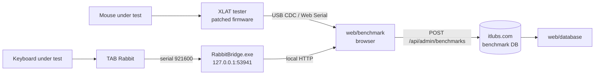

# itlubs-xlat-benchmark

Input-latency measurement tool used for the gear reviews on [itlubs.com](https://itlubs.com), for **mice and keyboards**:

- **Mouse click latency** — an [XLAT](https://github.com/teamfinalmouse/xlat) tester (patched firmware) driven from the browser over Web Serial.
- **Keyboard key latency** — a TAB Rabbit solenoid tester that physically presses the key; a small Windows bridge (`RabbitBridge`) drives it and times the OS key event, including Hall-effect / magnetic-switch keyboards.

Both paths collect press/release latency samples in one web UI, compute statistics and save results to the site's benchmark database.

> 한국어 요약: itlubs.com 리뷰용 **마우스·키보드 입력 지연 측정 도구**입니다. 마우스는 XLAT 측정기(Web Serial), 키보드는 전자석(솔레노이드)으로 키를 직접 누르는 TAB Rabbit을 Windows 브리지로 제어해(자석축/홀 키보드 포함) 누름/뗌 지연을 수집·통계 처리하고 사이트 DB에 저장합니다. 측정 웹은 XLAT 펌웨어를 수정해 웹에서 트리거를 걸 수 있게 했고, 그 패치를 함께 공개합니다.

## Contents

```
web/benchmark/index.html    measurement UI (Web Serial, XLAT + TAB Rabbit protocols, stats, chart, save)
web/database/index.html     results database page (admin edit + public list)
bridge/                     RabbitBridge: .NET 9 WinForms tray app, local HTTP on 127.0.0.1:53941
firmware/patches/           patches against teamfinalmouse/xlat v1.4.0 (GPL-3.0)
firmware/jlink/             J-Link Commander scripts (backup / flash / verify)
```



## Measurement design

- **XLAT path:** the patched firmware accepts `START`/`STOP` and settings over its virtual COM port, so the web page can run unattended repeat tests ("NEON tester": rounds × clicks × interval) instead of manual triggering. Samples are timed by XLAT's 1 MHz hardware timer.
- **Polling rate is never back-computed from click latency.** The configured rate comes from the USB endpoint `bInterval`; a measured rate is shown only when enough consecutive HID reports exist.
- **TAB Rabbit path:** the bridge opens the serial port at 921600 8N1, measures the CDC round-trip delay first and subtracts it, detects the key via a low-level keyboard hook, then measures press and release edges separately.
- **Quality flags:** each run stores the method, firmware version and quality reasons (e.g. too few samples) alongside min/avg/median/p95/stdev, so weak runs are visible instead of silently published.

## Firmware patches (GPL-3.0)

Base: `teamfinalmouse/xlat` tag **v1.4.0**.

- `xlat-v1.4.0-web-trigger.patch` — first version: serial command control for web-triggered tests.
- `itlubs-1.1.0` … `itlubs-1.1.3.patch` — cumulative "itlubs" builds (each applies alone on v1.4.0): selectable input trigger edge (falling / rising / both), version branding, larger FreeRTOS heap, USB host tweaks (1.1.3).

```sh
git clone --branch v1.4.0 https://github.com/teamfinalmouse/xlat.git && cd xlat
git apply ../firmware/patches/itlubs-1.1.3.patch
mkdir build && cd build
cmake .. -DCMAKE_TOOLCHAIN_FILE=arm-none-eabi.cmake -DCMAKE_BUILD_TYPE=Release && make -j
```

Both `itlubs-1.1.3` and `xlat-v1.4.0-web-trigger` were verified to apply and build with `gcc-arm-none-eabi` (Ubuntu 24.04); CI repeats this on every push. **Prebuilt firmware binaries are intentionally not included** — build from source. Flashing is at your own risk; take a backup first (`firmware/jlink/jlink-dump.jlink`).

## Keyboard bridge (TAB Rabbit)

The vendor's own TAB Rabbit / KeyRabbit desktop app is closed-source and is **not** included or redistributed here; this repo contains only my bridge and web UI that talk to the device.


```sh
cd bridge && dotnet publish -c Release   # Windows, .NET 9 SDK
```
The bridge listens only on `127.0.0.1:53941` (`/health`, `/status`, `/start`, `/stop`). The prebuilt `RabbitBridge.exe` served to the site admin is not part of this repo.

## Web pages

The pages are copies of what runs on itlubs.com. They call the site's own APIs (`/api/admin/benchmarks`, `/api/benchmarks`) and expect an authenticated admin session for saving; the server side lives in the site repository and is not included. Opened standalone they still work as a measurement UI over Web Serial (Chromium-based browsers).

## Role

Built by LUBY for the itlubs.com gear reviews: measurement method and requirements come from hands-on gear testing, and results were validated on real devices. Implementation was done with AI coding assistance.

## License

- `firmware/` — GPL-3.0-only (derivative of XLAT, see `firmware/COPYING`). XLAT © Finalmouse / contributors.
- Everything else (`web/`, `bridge/`) — MIT, see `LICENSE`.
